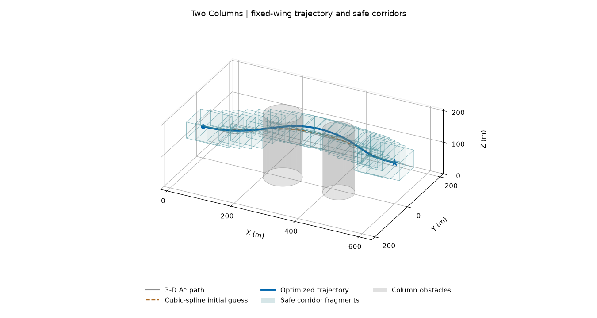
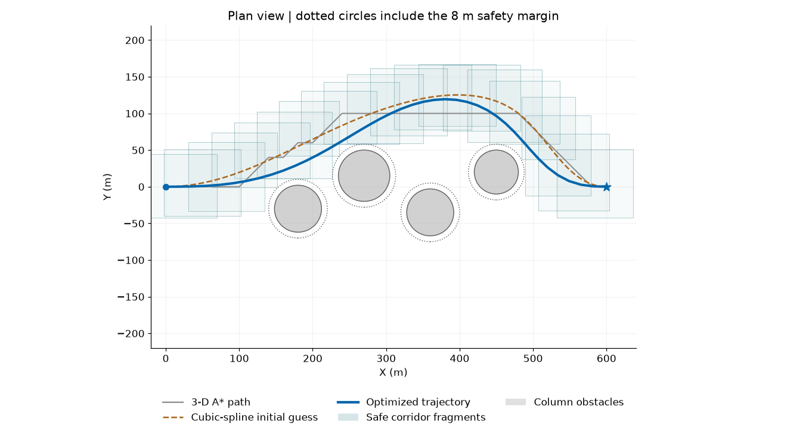
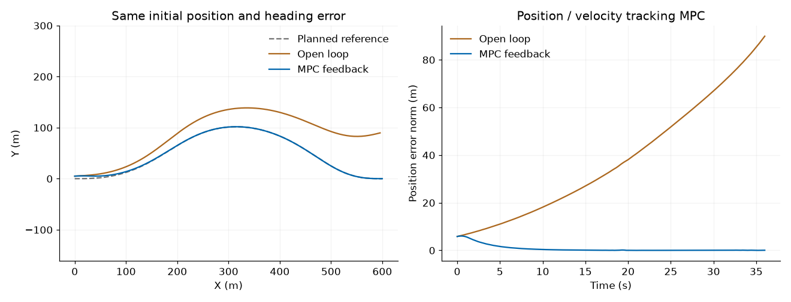

# 固定翼无人机航迹规划：三维 A*、安全走廊与数值最优控制

《低空飞行器智能控制技术》第二讲配套教学代码。提供 **Python 和 MATLAB 两套独立实现**，使用相同场景、模型、代价和约束，各自从头计算，不调用另一种语言，也不读取预先存好的轨迹充当求解结果。

运行 `RunMe.py` 或 `RunMe.m`，依次完成：

1. 在三维网格中运行 **26 邻接 A***，生成避障折线路径。
2. 对路径做视线捷径处理和**三次样条平滑**，重新检查整段曲线的安全性，再按弧长重采样。
3. 沿初始路径构造相互重叠的**三维安全走廊碎片**。
4. 以固定翼模型建立最优控制问题，经梯形离散化得到 NLP，使用带解析梯度的 SQP 类方法求解。
5. 绘制初始路径、样条初值、优化航迹、半透明柱形障碍和安全走廊，以及状态、控制量和收敛曲线。
6. 在双柱场景补充 **MPC 闭环跟踪**，比较相同初始偏差下的开环执行与反馈跟踪。





图中灰线为 A* 折线，棕色虚线为样条初始猜想，蓝线为优化航迹，浅青色箱体为走廊碎片；圆点和星号分别为起点、终点。三维图使用等比例坐标轴。俯视图中的点线圆包含 8 m 安全裕量。

## 一键运行

### Python

建议 Python 3.10 或更新版本。首次使用安装依赖；安装完成后，每次只需运行 `RunMe.py`。

```bash
git clone https://github.com/libai1943/uav_traj_plan_via_numerical_optimal_control.git
cd uav_traj_plan_via_numerical_optimal_control
python -m pip install -r requirements.txt
python RunMe.py
```

默认计算全部三个场景，保存图和数据，并打开绘图窗口。也可运行：

```bash
python RunMe.py --no-show                       # 无图形界面的机器；仍然保存所有图片
python RunMe.py --case two_columns              # 只运行双柱场景，含 MPC
python RunMe.py --case four_columns --no-show
python RunMe.py --skip-mpc                      # 只运行三组航迹规划
python -m unittest discover -s tests -v          # 在仓库根目录执行
```

Python 使用 NumPy、SciPy、Matplotlib，无需 MATLAB、CasADi、商用求解器或额外地图文件。希望对齐本次验证环境时，可使用 `requirements-tested.txt`；一般使用 `requirements.txt` 即可。

### MATLAB

需要 **MATLAB R2021b 或更新版本，以及 Optimization Toolbox**。不需要 Aerospace、UAV、Curve Fitting 或 Model Predictive Control Toolbox。

将 MATLAB 当前文件夹切换到仓库根目录，打开 `RunMe.m` 并点击 Run，或执行：

```matlab
RunMe                           % 三组规划 + 双柱场景 MPC；保存并显示图片
RunMe('two_columns')
RunMe('all', false)              % 不弹窗，仍保存图片
RunMe('all', false, false)       % 不弹窗，只运行规划
addpath('matlab'); test_core     % 几何与动力学回归检查
```

`RunMe.m` 会自行添加所需路径并在结束后恢复原有 MATLAB 路径。两个入口均以自身所在目录寻找配置文件；输出默认保存在仓库内。

## 场景与输出

三个场景均从 `[0, 0, 100] m` 出发，到达 `X=600 m, Y=0 m` 的终点；终点高度分别为 130、150、160 m。障碍数量分别为 2、4、5。柱体从地面延伸至 200 m，覆盖本例全部允许飞行高度，因而不能通过飞越柱顶规避约束。

场景参数统一放在 [`scenes.json`](scenes.json)。柱体每行为 `[中心 X, 中心 Y, 物理半径]`。默认设置如下。

| 参数 | 数值 |
|---|---|
| 规划时长 | 36 s，固定时长 |
| 离散区间 | 40；41 个状态节点和 41 个控制节点 |
| A* 网格步长 | X/Y/Z 分别为 20/20/10 m |
| 飞行高度、速度 | 75–180 m；15–25 m/s |
| 几何安全裕量 | 8 m，统一包含包络半径与预留间隙 |
| A* 附加净空 | 30 m，为样条平滑和转弯留出空间 |
| 走廊碎片 | 20 个，每个对应两个离散区间 |
| 区间内独立积分检查 | 每个区间 20 个 RK4 子步 |

运行后生成：

```text
outputs/
  python/ 或 matlab/
    summary.json
    two_columns/、four_columns/、five_columns/
      result.json                # 状态、输入、初值、A*、样条、箱体和检查结果
      result.npz 或 result.mat   # 本语言的数据文件
      trajectory_3d.png          # 等比例三维图
      trajectory_top.png         # 俯视图
      states_inputs.png          # 状态/控制量及幅值界限
      convergence.png            # 代价和约束残差
    two_columns/
      mpc_tracking.json
      mpc_tracking.png
```

`summary.json` 记录本次所选场景；各场景文件会在再次运行时更新。`outputs/` 不纳入 Git。`examples/` 中的图片和验证数据来自实际运行，仅用于仓库预览，求解程序不读取它们。

## 固定翼模型

采用无风、平地、定质量、协调飞行的**七状态质点模型**。状态和控制输入为

$$
\mathbf{x}=[X,Y,Z,V,\gamma,\chi,\mu]^{\mathsf T},\qquad
\mathbf{u}=[a_t,n,\omega_\mu]^{\mathsf T}.
$$

`X/Y/Z` 为东/北/上方向的位置，`V` 为速度，`gamma` 为航迹倾角，`chi` 为水平航迹方位角，`mu` 为升力方向的倾斜角。**航迹倾角不是机体俯仰角**；这里没有把三个角当作完整的机体欧拉角。

忽略推力法向分量，令切向比力 `a_t=(T cos(alpha)-D)/m`、载荷因子 `n=L/(mg)`，并将倾斜角速率作为输入，得到

$$
\begin{aligned}
\dot X&=V\cos\gamma\cos\chi,&
\dot Y&=V\cos\gamma\sin\chi,&
\dot Z&=V\sin\gamma,\\
\dot V&=a_t-g\sin\gamma,\\
\dot\gamma&=\frac{g}{V}(n\cos\mu-\cos\gamma),\\
\dot\chi&=\frac{gn\sin\mu}{V\cos\gamma},\\
\dot\mu&=\omega_\mu.
\end{aligned}
$$

该模型用于讲解数值规划，不包含完整气动系数、迎角动态、姿态内环或舵面分配。模型关系可对照 [MathWorks 的协调飞行质点方程](https://www.mathworks.com/help/aeroblks/fixedwingpointmass.html)；本代码自行实现这些方程及雅可比，不调用相关产品。

## 从 A* 初值到走廊约束

**A* 搜索的是三维位置网格。** 边代价是三维欧氏长度，启发函数是到终点的欧氏距离；每条斜向边都做整段碰撞检查，不仅检查两个端点。虽然本例的贯穿高度柱体使水平绕行占主导，搜索仍然包含高度邻接和非等高起终点。

A* 路径随后经过视线捷径处理和端点切向沿 X 轴的三次样条插值，再按弧长重采样。样条有可能切入障碍物，因此程序检查采样弦段，并用三次多项式二阶导数给出弦段与曲线的偏离上界；不安全时尝试保留更多 A* 路径点，仍不安全则报错。初始速度和角度由路径差分估计，控制量作近似构造并限幅。

这个初始猜想 **不保证满足动力学**。A* 也不是考虑固定翼转弯半径的 kinodynamic A*；固定翼运动关系、边值条件和幅值限制由后续 NLP 处理。

走廊采用便于课堂解释的轴对齐长方体，不复现 EGO-Planner 或任何论文的完整系统：

1. 用相邻三个初值位置点构造一个小箱体。
2. 逐个向六个方向膨胀，限制最大膨胀范围。
3. 每次判断**整个箱体**到柱面的距离，只有满足安全裕量才接受扩张。
4. 相邻箱体共享一个节点，该节点同时落入两个箱体；节点再向箱体内部收缩 1 m，给区间内轨迹留出余量。

箱体约束就是

$$\mathbf{l}_j\leq\mathbf{p}_k\leq\mathbf{h}_j.$$

柱体与箱体的整块距离通过柱轴到 XY 矩形的距离精确计算。**安全走廊是自由空间的保守子集**：选择了绕行通道并缩小可行域，不与原始避障问题等价，也不保证包含全局最优航迹。

## 最优控制问题与数值求解

优化量为所有离散状态与控制输入，共 410 个标量；初末七维状态固定。连续形式采用下列代价，离散时使用梯形权重：

$$
J=\int_0^{36}\left[
0.15(a_t/2)^2+2(n-1)^2+0.8(\omega_\mu/0.4)^2+0.02(Y/100)^2
\right]\,\mathrm{d}t.
$$

它惩罚控制输入偏离平飞值以及横向偏离，**不是经过能耗标定的燃油/电量模型**。约束包括：

- 运动微分方程的梯形离散等式；
- 初末位置、速度和角度的边值约束；
- 状态与控制输入的上下界；
- 分段走廊约束；
- 节点处的柱体距离约束 `(X-cx)^2+(Y-cy)^2 >= (R+8)^2`。

最后一项在整块安全箱体约束下是冗余的，保留它是为了把“名义避障约束”和“走廊约束”同时呈现在代码中。它不负责单独保证节点之间安全。

离散方程为

$$
\mathbf{x}_{k+1}-\mathbf{x}_{k}
-\frac{\Delta t}{2}\left[\mathbf{f}(\mathbf{x}_{k},\mathbf{u}_{k})
+\mathbf{f}(\mathbf{x}_{k+1},\mathbf{u}_{k+1})\right]=\mathbf{0}.
$$

由于模型含三角函数和速度分母，这里是**非凸 NLP，不是 QP 或仅含二次约束的 QCQP**。优化变量、运动残差均做尺度归一化，提供代价梯度与约束雅可比；每次运行还做有限差分核对。

Python 使用 [SciPy SLSQP](https://docs.scipy.org/doc/scipy/reference/optimize.minimize-slsqp.html)，MATLAB 使用 [`fmincon` 的 SQP](https://www.mathworks.com/help/optim/ug/fmincon.html)。两者可落在略有不同的局部候选解上；这里将其称为“优化航迹”，**不声称找到了连续问题的全局最优解**。尤其是 MATLAB `exitflag=2` 表示步长终止且满足可行性容差，不能解读为严格的最优性证明。

## MPC 跟踪补充实验



双柱场景额外设置 5 m 横向偏差、3 m 高度偏差和 3° 航迹方位偏差。开环组和 MPC 组使用相同初始状态、相同非线性模型。

- **预测模型**：沿规划参考逐点线性化，采用 0.2 s 采样；用矩阵指数离散化局部线性模型，并保留参考离散缺陷的仿射项。
- **滚动优化**：预测 15 步，即 3 s。代价跟踪位置和速度向量，并包含少量状态正则化与输入修正惩罚；约束绝对输入幅值。得到正定的带箱约束 QP，以代码内的对数障碍牛顿方法求解，每步核对投影梯度残差。
- **反馈校正**：以“参考状态减去当前状态”作为误差，求得整段输入修正后仅执行第一步，再读取新状态，重新求解。上一轮修正序列移位后作为下一轮**暖启动**。

被控对象用原非线性方程做 RK4 积分，输入按采样周期零阶保持。终点后参考继续平飞，以避免错误地令固定翼原地悬停。此处直接使用仿真真值作为反馈，没有声称实现状态估计器；没有连续风扰，也没有在 MPC 的 QP 中添加走廊/状态约束。因此这是跟踪架构演示，不构成闭环避障或鲁棒稳定性的保证。

## 实际验证与数值边界

以下为 **2026-10-11** 的运行记录。Python 3.12.14 / NumPy 2.5.4 / SciPy 1.18.1 / Matplotlib 3.11.2；MATLAB R2021b Update 7 + Optimization Toolbox。完整数值见 [`examples/validation_results.json`](examples/validation_results.json)。

| 版本 | 场景 | 代价 J | 最大归一化约束残差 | 区间内最小柱面净空 / m | 最大区间位置缺陷 / m |
|---|---|---:|---:|---:|---:|
| Python | 双柱 | 0.991388 | 2.26e-10 | 22.048 | 0.105 |
| Python | 四柱 | 2.024124 | 2.02e-10 | 21.052 | 0.181 |
| Python | 五柱 | 1.350300 | 4.46e-11 | 36.998 | 0.030 |
| MATLAB | 双柱 | 1.009338 | 1.74e-14 | 22.777 | 0.110 |
| MATLAB | 四柱 | 2.022353 | 5.13e-14 | 20.942 | 0.182 |
| MATLAB | 五柱 | 1.349614 | 5.40e-13 | 37.000 | 0.029 |

六次规划均未出现检查到的区间内走廊越界，所有箱体的整块净空均大于 8 m。一次规划的**优化器阶段**约 3–12 s；这不包含 A*、绘图、MPC 和程序启动耗时，机器与库版本不同会有变化。

双柱跟踪实验中，Python 的位置误差 RMS 为 MPC **1.600 m**、开环 **45.282 m**；MATLAB 分别为 **1.601 m** 和 **45.330 m**。这是本场景的实测值，不是任意场景的性能承诺。

检查有两个不同层次，不能混淆：

1. **区间检查**从每个离散状态节点重新出发，线性插值输入，细分为 20 个 RK4 子步；报告局部位置缺陷、柱面净空和走廊越界。若归一化残差大于 `1e-5`、安全裕量不足、走廊越界，或局部位置缺陷大于 `0.5 m`，本次运行会报错。
2. **整段开环积分**只从起点出发，一直积分到终点。记录其终端位置误差与最小净空。它没有在每个节点重置，因而会累计离散化误差；本次终端位置误差约 **0.30–1.67 m**。这些诊断量会保存，不会被隐藏为零。

密集采样检查不等于连续时间可行性的严格证明，优化图也只是节点间的连线。要提高精度，可增加 `intervals` 并比较结果；本示例没有自动网格细化、完整固定翼气动校核或实飞验证。

修改场景时，起终点需落在配置的 A* 网格上，`intervals` 必须为偶数。狭窄走廊、急转弯、过短时长等可能使固定翼 NLP 不可行；程序会报错，不会换成手画轨迹或伪造成功结果。

## 代码位置

| 内容 | Python | MATLAB |
|---|---|---|
| 一键入口 | `RunMe.py` | `RunMe.m` |
| 三维搜索、样条和走廊 | `python/geometry.py` | `matlab/astar3d.m`、`spline_seed.m`、`build_corridors.m` |
| 固定翼方程及雅可比 | `python/model.py` | `matlab/fw_motion.m` |
| NLP 建模、求解与验证 | `python/planner.py` | `matlab/plan_fixedwing.m` |
| 绘图 | `python/plotting.py` | `matlab/plot_result.m` |
| MPC 与箱约束 QP | `python/tracking.py` | `matlab/track_mpc.m` |
| 回归测试 | `tests/` | `matlab/test_core.m` |

测试覆盖“端点安全但连线碰撞”“四角安全但箱体内部碰撞”、三维邻接与样条安全、平飞平衡、非平衡点处全部动力学导数，以及具有已知边界最优解的 QP。完整三组求解与区间验证由 `RunMe` 执行。
